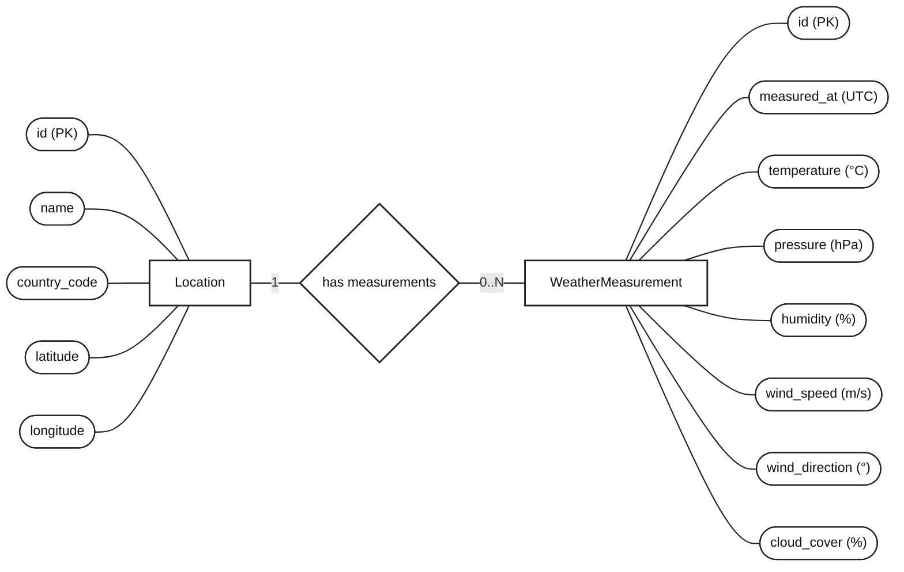

# Diagram ERD pogodynki — notacja Chena

Prostokąty oznaczają encje, owalne węzły — atrybuty, a romb — relację. Diagram wykorzystuje [składnię flowchart Mermaid](https://mermaid.js.org/syntax/flowchart.html).

`PK` oznacza klucz główny. Encja `Location` reprezentuje miejscowość, a `WeatherMeasurement` — pomiar pogody. Relacja `1 : 0..N` oznacza, że miejscowość może mieć od zera do wielu pomiarów, a każdy pomiar należy do jednej miejscowości. W modelu relacyjnym tę relację realizuje klucz obcy `WeatherMeasurement.location_id` wskazujący na `Location.id`.
